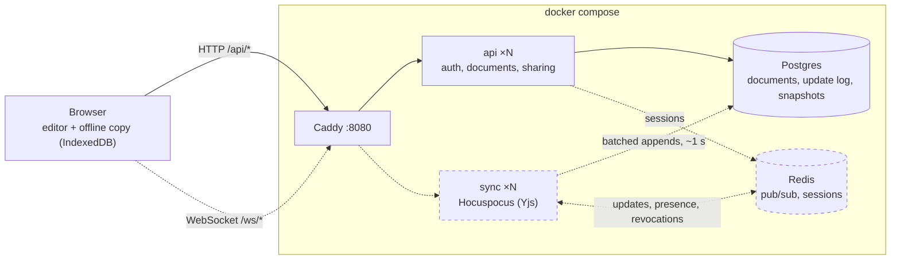

# Collaborative editor

Several people edit one document in real time, keep editing offline, and everything merges when they reconnect.

The step-by-step build plan is in [PLAN.md](PLAN.md).

> **Status:** skeleton. The stack runs, scales and passes CI. The product itself isn't built yet.

## Run it

```bash
git clone --recurse-submodules https://github.com/gonzalo-gigena/collab-editor.git
cd collab-editor
cp .env.example .env
docker compose up --watch
```

Open http://localhost:8080. Needs only Docker with Compose v2. Code changes reload
automatically (Compose Watch). On Windows, clone inside the WSL filesystem, not `/mnt/c`.

Cloned without `--recurse-submodules`? Run `git submodule update --init`.

## Everyday commands

| What | Command |
|---|---|
| Seed demo data | `docker compose run --rm seed` |
| SQL shell | `docker compose exec db psql -U app app` |
| Scale the api | `docker compose up -d --scale api=3` |
| Prove scaling works | `sh common/scripts/smoke.sh 3` |
| Run exactly what CI runs | `sh common/scripts/ci-stack.sh 3` |
| Load test at 1, 2, 4 replicas | `sh common/scripts/scale.sh` |
| Metrics (Prometheus) | `docker compose --profile observability up -d`, then http://localhost:9090 |
| Unit tests | `docker run --rm -v "$PWD/apps/api:/app" -w /app node:26.13-bookworm-slim node --test` |
| New migration | add `infra/db/migrations/00000N_name.up.sql` + `.down.sql`, restart |
| Update shared code | `git submodule update --remote common` |
| Reset everything | `docker compose down -v` |

## Architecture



Solid boxes and arrows run today. Dashed ones are planned in [PLAN.md](PLAN.md).

Edits travel over a WebSocket to any `sync` replica. Redis relays them to the other replicas that have the same document open, and Postgres keeps an append-only log of updates plus periodic snapshots.

## Stack

- **api:** Node 26 (`node:http` + `pg`), plain JavaScript. Stateless, so it scales with `--scale api=N`.
- **Caddy:** the only service with a host port. It load-balances `/api/*` across every
  replica (`import lb api 8080`, from common) and serves `apps/web`.
- **Postgres 18:** migrations run once before the api starts (`golang-migrate`).
- **common/:** git submodule with the shared fakes, scripts, Caddy snippet and Prometheus.
  See [portfolio-common](common/README.md).

## Deploy (one VM)

```bash
docker compose -f compose.yaml -f compose.prod.yaml up -d
```

The server's `.env` needs `SITE_ADDRESS`, `IMAGE_REPO`, `TAG`, a strong password, and no `fakes`
profile. Caddy gets TLS automatically. CI pushes multi-arch images to GHCR on every merge to `main`.

## Decisions & tradeoffs

| Decision | Chosen | Rejected | Why, and what it costs |
|---|---|---|---|
| Merging concurrent edits | Yjs (a CRDT) | Operational transform (ShareDB) | A CRDT merges edits made offline without a server ordering every operation. OT needs that server, so offline editing breaks. Cost: deleted text leaves tombstones, so a document only grows until compacted. |
| Sync server | Hocuspocus | A hand-written `y-websocket` server | Auth hooks, persistence hooks and a Redis extension already exist, so there's less code to get wrong. |
| Storage | Append-only update log, plus a snapshot every ~500 updates (`bytea` in Postgres) | Rewriting the whole document on every save | Appends are cheap and never overwrite an edit. Snapshots keep loads fast. Cost: compaction could delete an update that commits late, so append and compaction take the same advisory lock per document. |
| Write rate | Batch updates for ~1 s per document | One INSERT per keystroke | Postgres writes are the bottleneck. A crash loses at most ~1 s on the server, and clients send it again on reconnect, because Yjs syncs by state vector in both directions. |
| Several sync replicas | Redis pub/sub between replicas, so any replica serves any document | Routing each document to one replica | Plain round-robin works, and a replica can die without a handoff. Cost: one Redis carries all the fan-out. |
| Permissions | Enforced in `sync`: updates from viewers are rejected server-side | A read-only editor in the UI | Anyone can send updates from devtools. |
| Load balancing | Caddy `dynamic a` upstreams (the `lb` snippet in `common/`) | `reverse_proxy api:8080`, Traefik | Caddy re-reads Docker DNS every 5 s, so `--scale api=N` needs no config change and no Docker socket mount. A plain `reverse_proxy api:8080` is a single upstream to Caddy and doesn't reliably spread load. |
| Migrations | A one-shot `migrate` service that finishes before the api starts | Each replica migrating on boot | Replicas starting together would race on the same migration. |

Rows for parts that aren't built yet record the plan's choice. Each one gets confirmed or revised when that phase is built.

## Scaling

### Measured

The skeleton only, not the product yet: k6 with 20 virtual users for 20 s against `GET /api/hello`, which reads one row from Postgres through Caddy. Run on an Apple M1 laptop with 8 CPUs and 8 GB given to Docker, with the dev override left out:

```bash
COMPOSE_FILE=compose.yaml sh common/scripts/scale.sh
```

| api replicas | req/s | p95 latency | failed |
|---|---|---|---|
| 1 | 15,521 | 2.33 ms | 0.00% |
| 2 | 13,853 | 2.8 ms | 0.00% |
| 4 | 10,708 | 3.85 ms | 0.00% |

4 replicas served 0.7× the requests of 1. At 1 replica the api used about one core, while Caddy, Postgres and k6 together used about four of the laptop's eight (sampled with `docker stats` during the run). The api isn't the bottleneck on one machine, so more replicas only compete for the same CPUs. Replicas pay off when the api is the busiest process, and a hello endpoint doing one query isn't.

### How each part scales

| Part | Scales by | Limit |
|---|---|---|
| `api` | `--scale api=N` (stateless) | Postgres connections. Add PgBouncer past ~2 replicas. |
| `sync` | `--scale sync=N`, with Redis relaying updates | A WebSocket stays on the replica it first reached. Only new connections spread. |
| Postgres | One primary | Write rate of the update log. Batching and compaction keep it small. |
| Redis | One instance | Pub/sub fan-out across all active documents. |

### Where it breaks next

- **Redis pub/sub, at around 100k active documents.** Next: assign documents to `sync` replicas by consistent hashing, so each update stays on one replica.
- **Postgres write rate.** Widen the batch window first, then split documents across databases.
- **Very large documents.** The first sync message carries the whole document, so documents are capped (about 5 MB). Past that, lazy-load or split them.

Phase 8 adds the real test: 500 WebSocket clients across 50 documents, one edit per second each, with p50/p95 propagation latency at `sync=1` vs `sync=3`.
